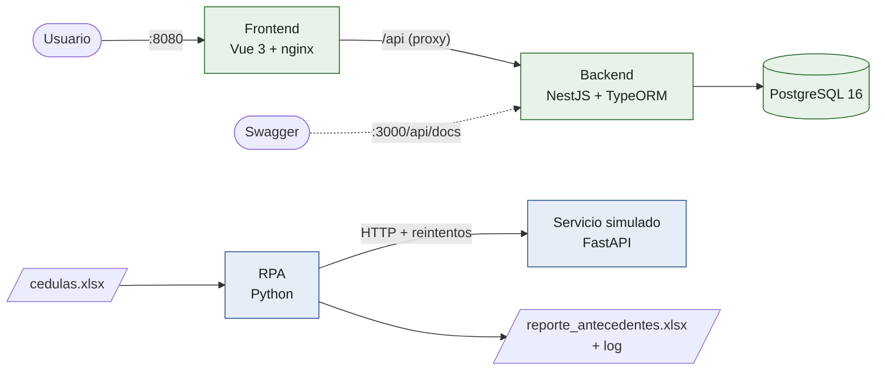
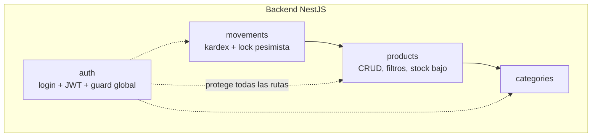
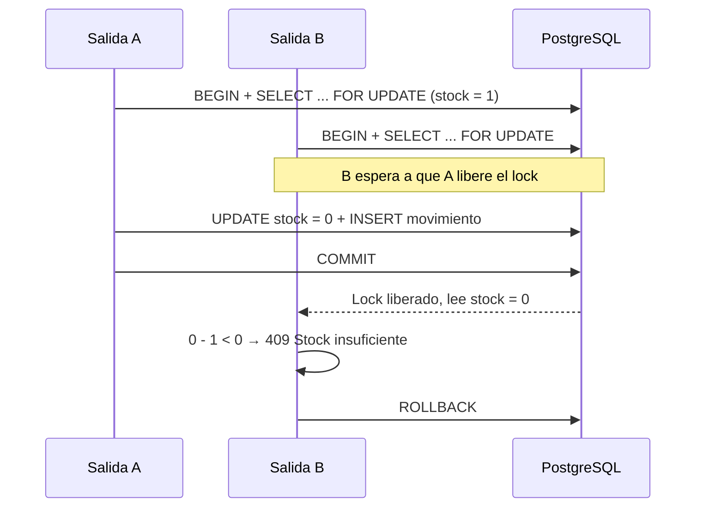
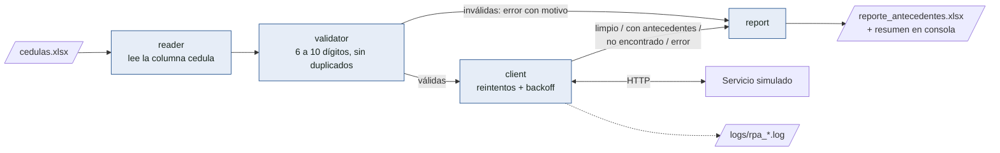

<p align="center">
  
</p>

<h1 align="center">Prueba técnica · Desarrollador Full Stack</h1>
<p align="center">VISE Ltda — Mini sistema de inventario + RPA de consulta de antecedentes</p>

---

¡Hola! 👋 Este repositorio tiene las dos partes de la prueba: un **sistema de inventario** (NestJS + Vue 3) y un **RPA de consulta de antecedentes** (Python). Todo se levanta con un solo `docker compose up`. Las decisiones técnicas están resumidas en [`DECISIONES.md`](DECISIONES.md).

## Contenido

- [Vista general](#vista-general)
- [Cómo levantarlo](#cómo-levantarlo)
- [Parte 1: Inventario](#parte-1-inventario)
- [Parte 2: RPA de antecedentes](#parte-2-rpa-de-antecedentes)
- [Pruebas](#pruebas)
- [Variables de entorno](#variables-de-entorno)
- [Estructura del repositorio](#estructura-del-repositorio)

## Vista general



## Cómo levantarlo

Solo necesitas **Docker Desktop** (o Docker Engine con Compose v2) y **Git**.

```bash
git clone https://github.com/davecoude/vise-prueba-tecnica.git
cd vise-prueba-tecnica
cp .env.example .env          # en PowerShell: Copy-Item .env.example .env
docker compose up -d --build  # la primera vez tarda unos minutos
docker compose ps             # db, backend, frontend y antecedentes-mock en (healthy)
```

| Qué | Dónde |
|---|---|
| Aplicación web | http://localhost:8080 |
| API REST | http://localhost:3000/api |
| Documentación de la API (Swagger) | http://localhost:3000/api/docs |
| Servicio simulado de antecedentes | http://localhost:8000/docs |

**Usuario de prueba:** `admin@vise.com` / `Admin123*`

Al arrancar pasan varias cosas solas: el backend aplica las migraciones y carga los datos de prueba, y el **RPA se ejecuta una vez** con el Excel de ejemplo. El reporte queda en `rpa/output/` y el log en `rpa/logs/`.

```bash
docker compose logs rpa       # ver el resumen del RPA
docker compose run --rm rpa   # volver a ejecutar el RPA
docker compose down           # detener todo (con -v también borra la base de datos)
```

## Parte 1: Inventario

**Stack:** NestJS 12 · TypeORM 1 · PostgreSQL 16 · Vue 3 + Vite · Docker

### Qué hace

- Login con JWT: contraseñas con bcrypt y token con expiración. **Todas** las rutas están protegidas por un guard global; solo `login` y `health` son públicas.
- CRUD de productos con validación. El SKU es único y se guarda en mayúsculas.
- Listado con paginación, filtro por categoría y búsqueda por nombre o SKU.
- Entradas y salidas de inventario. Si una salida deja el stock en negativo, se rechaza con `409`.
- Kardex por producto con el saldo acumulado en cada movimiento.
- Productos con stock por debajo de un umbral configurable.
- Migraciones y datos semilla.

### Módulos del backend



### ¿Cómo se evita que el stock quede mal con salidas simultáneas?

Cada movimiento corre en una transacción que **bloquea la fila del producto**. Si dos salidas llegan al mismo tiempo, la segunda espera a que termine la primera y calcula con el stock actualizado:



Y por si acaso, la base de datos tiene un `CHECK (stock >= 0)` como última barrera.

### Endpoints principales

| Método | Ruta | Para qué sirve |
|---|---|---|
| `POST` | `/api/auth/login` | Iniciar sesión y obtener el JWT |
| `GET` | `/api/products?page&limit&categoryId&search` | Listado paginado con filtros |
| `GET` | `/api/products/low-stock?threshold` | Productos con stock bajo |
| `POST` / `PATCH` / `DELETE` | `/api/products[/:id]` | Crear, editar y eliminar productos |
| `POST` | `/api/products/:id/movements` | Registrar una entrada o salida |
| `GET` | `/api/products/:id/kardex` | Historial con saldo acumulado |
| `GET` | `/api/categories` | Categorías |

El detalle completo, con esquemas y códigos de respuesta, está en Swagger.

### Desarrollo local (opcional, sin Docker para el código)

```bash
docker compose up -d db
cd inventario/backend && npm install && npm run start:dev   # necesita inventario/backend/.env.local con DB_HOST=localhost y DB_PORT=5433
cd inventario/frontend && npm install && npm run dev       # http://localhost:5173
```

## Parte 2: RPA de antecedentes

> ⚠️ El RPA consulta un **servicio simulado con datos ficticios**. Las consultas reales de antecedentes requieren autorización del titular y el uso de canales oficiales.

**Stack:** Python 3.12 · openpyxl · requests · logging · FastAPI (servicio simulado) · Docker

### Cómo funciona



- El **reporte** tiene las columnas `cedula`, `nombres`, `estado`, `detalle` y `fecha_consulta`, más una hoja de resumen.
- Si una consulta falla, se marca como `error` y **el proceso sigue** con las demás.
- Las cédulas inválidas no se consultan: salen en el reporte con estado `error` y el motivo.
- El **log** registra cada intento con fecha y hora. La cédula aparece enmascarada (`10******81`) porque es un dato personal.

### Usarlo desde la línea de comandos (sin Docker)

```bash
cd rpa
python -m venv .venv
source .venv/bin/activate              # Windows (Git Bash): source .venv/Scripts/activate
pip install -e ".[dev]" -r mock_service/requirements.txt

# Terminal 1: servicio simulado
cd mock_service && uvicorn app:app --port 8000

# Terminal 2: RPA
rpa-antecedentes --input data/cedulas.xlsx --output output/reporte_antecedentes.xlsx
rpa-antecedentes --help                # todas las opciones
```

Códigos de salida: `0` proceso completado, `2` archivo de entrada inválido, `1` error inesperado.

### Casos incluidos en el Excel de ejemplo

| Caso | Qué pasa |
|---|---|
| Cédulas válidas | `limpio`, `con antecedentes` o `no encontrado` |
| Duplicadas (incluso una como texto y otra como número) | Se consultan una sola vez |
| Con 5 u 11 dígitos, con puntos o con letras | `error` con el motivo, sin consultar |
| Terminada en `13` | El servicio falla 2 veces y luego responde: se ve un reintento exitoso |
| Terminada en `99` | El servicio siempre responde 500: se agotan los reintentos y queda en `error` |
| Terminada en `77` | El servicio tarda más que el timeout: reintentos por timeout y queda en `error` |

Resultado esperado:

```
 Total consultado/reportado :     21
 Limpios                    :     12
 Con antecedentes           :      2
 No encontrados             :      1
 Errores                    :      6
   (cédulas inválidas)      :      4
 Duplicados eliminados      :      3
```

## Pruebas

| Proyecto | Comando | Qué cubre |
|---|---|---|
| Backend | `cd inventario/backend && npm test` | 19 pruebas unitarias del servicio de movimientos: lock, saldos, stock insuficiente, kardex |
| Backend | `npm run test:concurrency` (con la API arriba) | 20 salidas simultáneas sobre el mismo producto |
| RPA | `cd rpa && python -m pytest` | 51 pruebas: datos inválidos, servicio caído, reintentos, log y reporte |

En Docker, las pruebas unitarias corren durante el build: si alguna falla, la imagen no se construye.

## Variables de entorno

Están todas documentadas en [`.env.example`](.env.example). Las principales:

| Variable | Para qué |
|---|---|
| `DB_*` | Conexión a PostgreSQL |
| `JWT_SECRET`, `JWT_EXPIRES_IN` | Firma y expiración del token |
| `SEED_USER_EMAIL`, `SEED_USER_PASSWORD` | Usuario de prueba |
| `LOW_STOCK_DEFAULT_THRESHOLD` | Umbral por defecto de stock bajo |
| `API_HOST_PORT`, `WEB_HOST_PORT`, `MOCK_HOST_PORT` | Puertos publicados en tu equipo |
| `MOCK_FAILURE_RATE` | Probabilidad de fallos aleatorios del servicio simulado |
| `RPA_TIMEOUT_S`, `RPA_MAX_REINTENTOS` | Política de reintentos del RPA |

## Estructura del repositorio

```
├── assets/                    Logo de VISE
├── inventario/
│   ├── backend/               API NestJS (auth, products, categories, movements)
│   └── frontend/              Interfaz Vue 3 servida por nginx
├── rpa/
│   ├── src/rpa_antecedentes/  reader · validator · client · report · pipeline · cli
│   ├── mock_service/          Servicio simulado de antecedentes (FastAPI)
│   ├── tests/                 Pruebas del RPA
│   ├── data/                  Excel de entrada de ejemplo
│   ├── output/                Reportes generados
│   └── logs/                  Un log por ejecución
├── docker-compose.yml
├── .env.example
└── DECISIONES.md              Decisiones técnicas
```

---

Hecho por **Diego Vanegas** · [davecoude.vercel.app](https://davecoude.vercel.app) · [GitHub](https://github.com/davecoude)
